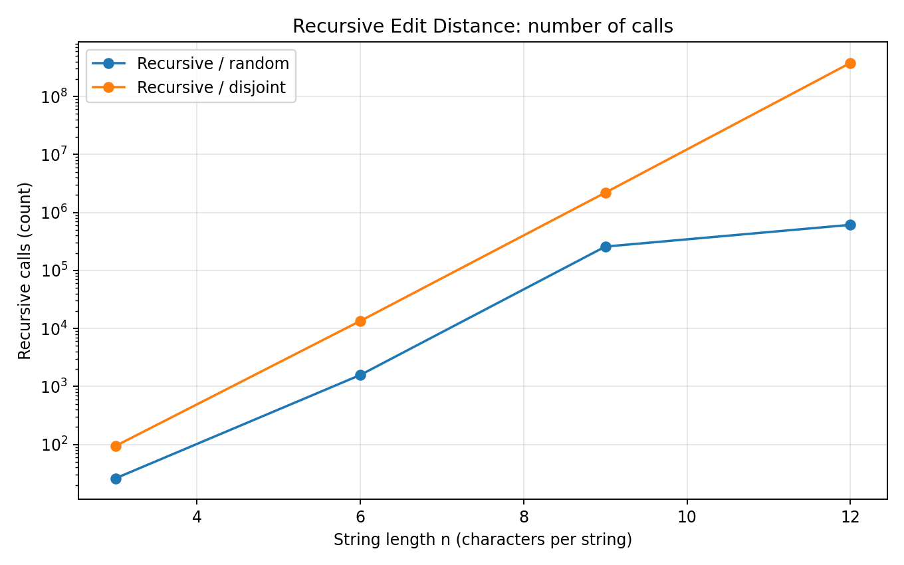
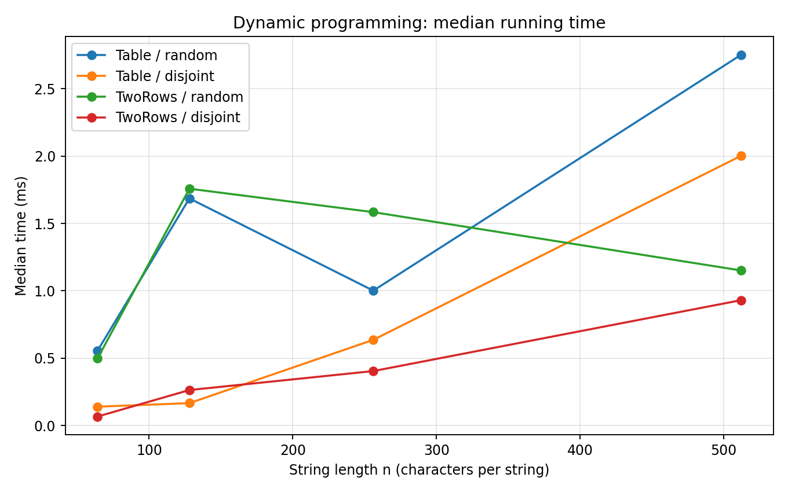
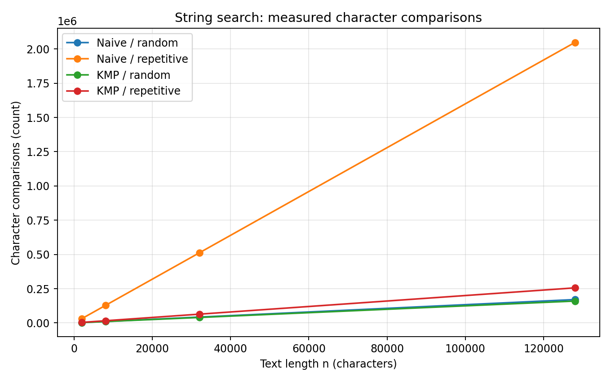
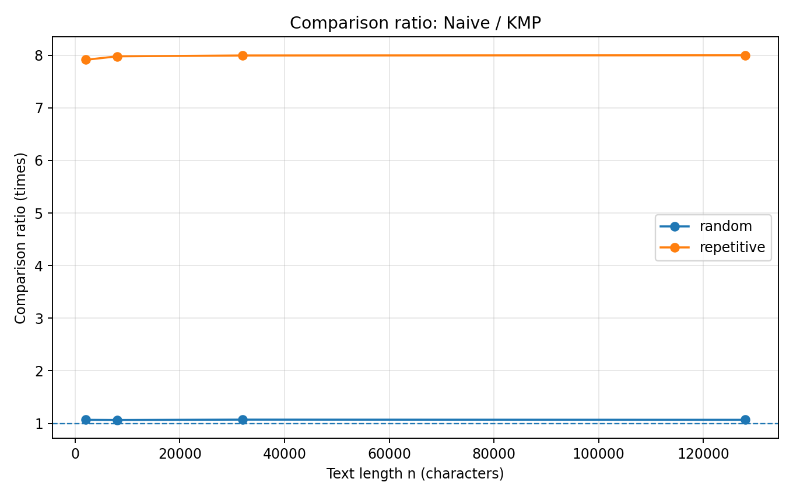

# Assignment 4 — Dynamic Programming and String Algorithms
**Student:** Abdubek Alina  
**Group:** SE-2516  
**Course:** Design and Analysis of Algorithms

## 1. Experiment Design Card (prepared before running)

| Field | Edit Distance | String Search |
|---|---|---|
| Question | How do recursive calls grow compared with the work done by DP, and does storing only two rows affect runtime? | How much does KMP reduce character comparisons on repetitive input compared with Naive search? |
| Sizes (n) | Recursive: 3, 6, 9, 12. Table and TwoRows: 64, 128, 256, 512. Each largest size is at least four times the smallest. | Text lengths 2,000, 8,000, 32,000, 128,000; pattern length fixed at 16. |
| Inputs | `random`: two seeded strings over `abcd`, representing typical edits. `disjoint`: all `a` versus all `b`, intentionally forcing the recursive mismatch branches. | `random`: seeded text over `abcd`, with one 16-character pattern copied from its center. `repetitive`: all `a` text and pattern `aaaaaaaaaaaaaaab`, forcing repeated almost-matches. |
| Metrics | Elapsed milliseconds (each of five runs, and median in charts). Recursive method counts recursive calls; DP methods count computed inner cells. | Elapsed milliseconds and actual character comparisons. KMP counts comparisons both while building LPS and during text scanning. |
| Prediction | DP will perform n² cell updates; recursion on disjoint inputs will expand extremely fast. TwoRows will save memory without changing the number of computed cells. | Naive will do close to 16 comparisons per start position on repetitive input, while KMP should stay linear in text length. |
| Plots | Recursive call count on log y-axis; DP median runtime. | Search comparison counts and Naive/KMP comparison ratio. |

**Generation and measurement protocol.** `InputGenerator` uses `java.util.Random` with fixed seed 2516 (and an offset based only on n). Each method processes identical inputs for its size and case. All counters are incremented inside the algorithms, and each case is timed five times using `System.nanoTime()`. Raw runs are saved in `results/results.csv`; charts use the median of five timings. The fixed seed reproduces inputs, outputs and counters; time will vary with CPU load, JVM JIT compilation and hardware. The measurement code was not changed after inspecting initial results.

## 2. Plots and results

*Figure 1. The disjoint-character case makes plain recursion grow extremely quickly, as shown by the logarithmic y-axis.*

*Figure 2. Both DP implementations finish the same quadratic number of updates, while measured timing is noisy and sensitive to memory allocation and JVM warm-up.*

*Figure 3. Repetitive text causes many more Naive comparisons, whereas KMP's LPS skips previously matched prefixes.*

*Figure 4. The Naive-to-KMP comparison ratio is much higher for repetitive near-matches than for seeded random text.*

### Representative observations at the largest size

| Algorithm | Input | n | Median time (ms) | Operations |
|---|---|---:|---:|---:|
| Recursive | random | 12 | 1.3865 | 610,868 calls |
| Recursive | disjoint | 12 | 826.7672 | 377,393,953 calls |
| Table | random | 512 | 2.7512 | 262,144 cells |
| TwoRows | random | 512 | 1.1512 | 262,144 cells |
| Naive | repetitive | 128,000 | 4.6112 | 2,047,760 comparisons |
| KMP | repetitive | 128,000 | 0.7489 | 256,014 comparisons |

The source of truth is the unrounded CSV; the values above are medians from the measured run on the local OpenJDK 21 environment.

## 3. Prediction versus result

**Edit Distance.** The prediction was that full-table and two-row DP would calculate the same quadratic number of states, while un-memoized recursion would become infeasible for mismatching characters. At n=512, both DP implementations counted exactly 262,144 updates, confirming O(n²) work on equal-length strings. In the disjoint recursive case, n=12 already required 377,393,953 calls and approximately 827 ms median, compared with a few milliseconds for DP at much larger sizes. Recursive timing on random input is not monotonic because equal last characters eliminate branches; JIT compilation and small durations also distort timing.

**String Search.** The prediction was that a long nearly matching pattern would be particularly costly for Naive search. For 128,000 repetitive characters, Naive counted 2,047,760 comparisons versus 256,014 for KMP, an approximately 8.0× reduction. The KMP count includes construction of LPS, making the comparison more complete. On random text, much earlier mismatches mean that Naive's comparison count is much closer to KMP's; their exact clock times are not guaranteed to have the same ordering.

## 4. Short answers

**Which input made your string search slowest, and why?** The repetitive input was the hardest one for Naive search. At nearly every position, the first 15 `a` characters match and the final `b` mismatches. The next start position repeats almost all of that work. KMP uses its prefix table to avoid restarting the same comparisons, so the difference is visible in the counters.

**How large an n could recursive Edit Distance handle, and what stopped it?** The experiment deliberately stopped at n=12 for the disjoint strings, where recursion still finished but counted 377,393,953 calls and had a median time of about 827 ms. Bigger disjoint examples would rapidly multiply the work without teaching much more. The limiting factor is repeated evaluation of the same subproblems, not a correctness issue. Therefore n=12 is the largest *tested* value, not a universal hard maximum.

**What do you gain and lose using two rows?** Two rows reduce auxiliary memory from O(nm) integers to O(min(n,m)) integers by keeping only the previous and current rows. The optimal distance stays identical and the number of DP cell updates does not change. The trade-off is that the complete alignment table is unavailable for reconstructing an edit sequence without extra work. The measured runtime may improve due to less allocation, but that is not guaranteed on every computer.

**Which string search would you choose for a city platform, and why?** I would choose KMP when searching large text logs for a fixed pattern. It has linear O(n+m) worst-case time, handles overlapping occurrences, and prevents the repeated-prefix worst case for Naive. Naive search is simpler and can be competitive on short, ordinary strings. For unpredictable long log files, KMP gives a stronger performance guarantee.

## 5. About measured time

All time values are measured rather than estimated, and the CSV preserves all five individual runs for every algorithm/input/size combination. The plots use medians to reduce the effect of unusual runs, although the JVM may still warm up during the experiment and background workload may change. Especially at small sizes, clock values should not be interpreted as reliable asymptotic evidence; they may be nonmonotonic and depend on allocation or JIT optimization. The counters provide an independent, reproducible explanation: quadratic DP cell counts, exponential-like recursive call explosion on disjoint strings, and the lower KMP comparison counts on repetitive inputs. This is why the conclusions rely on both measured timings and internal work counters.
